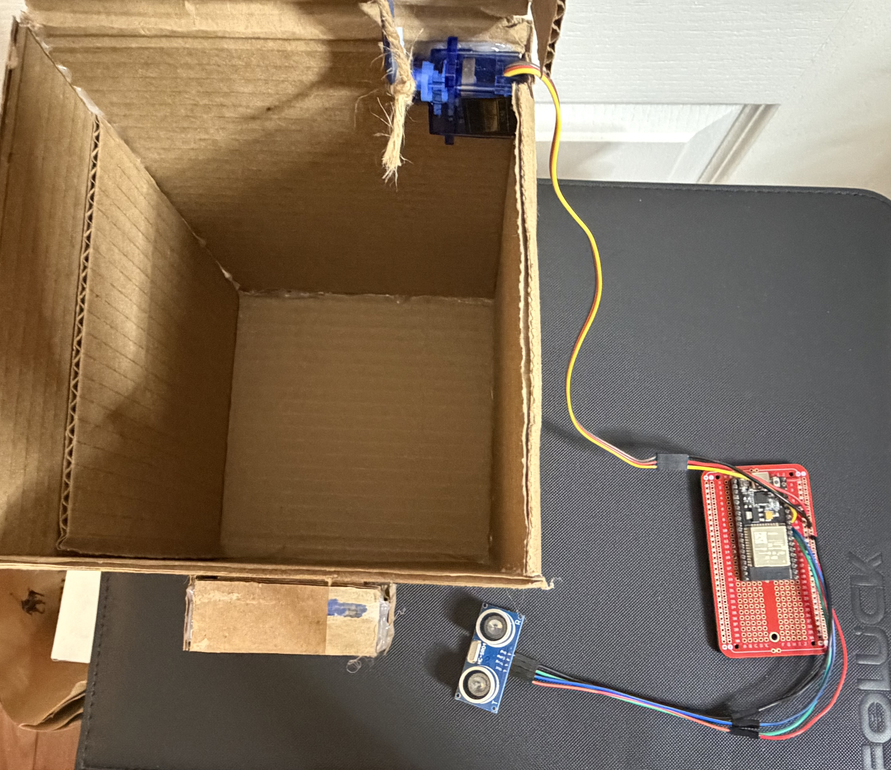
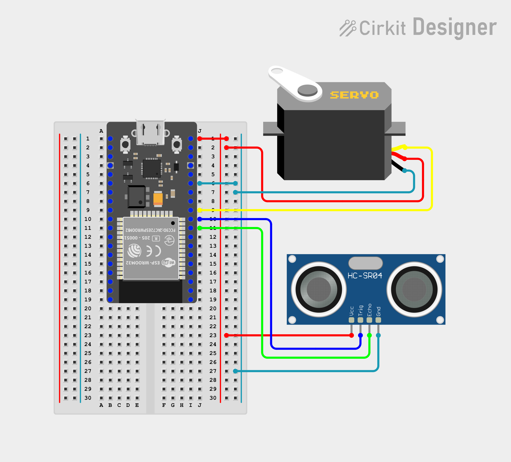

# Automated Trash Can

An ultrasonic-sensor-triggered automated trash can that opens its lid when an object or hand approaches, built using an ESP32 and a servo motor.

## Overview
This project uses an ESP32 microcontroller paired with an HC-SR04 ultrasonic distance sensor to detect when someone approaches the trash can. When an object is within range, the ESP32 signals an SG90 servo motor to open the lid automatically, eliminating the need to touch the can.

## Internal Components

## Circuit Diagram

## Build Process
The enclosure was hand-built from a cardboard box, with a popsicle stick and twine rigged to the servo arm to mechanically pull the lid shut, since the servo's rotation alone wasn't enough to fully close it. Hot glue was used throughout to secure the servo mount, sensor housing, and structural joints.

All components except the servo and ultrasonic sensor were assembled on a breadboard PCB. The servo and sensor were connected separately via soldered wire leads, since their placement on the enclosure required longer runs than the breadboard could accommodate directly. This low-cost prototyping approach let me iterate quickly on both the mechanical design and the wiring layout.

## How It Works
- **HC-SR04 ultrasonic sensor:** continuously measures distance to detect when an object (hand/trash) is nearby
- **ESP32:** reads the distance value and triggers the servo when an object is within the threshold range
- **SG90 servo motor:** rotates to lift the lid open; twine connected to the servo arm pulls the lid closed after a delay

## Components
| Component | Purpose |
|---|---|
| ESP32 (WROOM-32) | Main microcontroller |
| HC-SR04 Ultrasonic Sensor | Detects proximity to trigger lid |
| SG90 Servo Motor | Opens and closes the lid |
| Breadboard PCB | Houses main circuit connections |
| Cardboard | Trash can enclosure |
| Popsicle Stick | Lever arm extension for lid mechanism |
| Twine | Connects servo arm to lid for closing motion |
| Hot Glue | Assembles and secures enclosure and components |
| Soldered Wire Leads | Connects servo and sensor to the circuit |

## Code
Full source code: [`src/trash_can.ino`](src/trash_can.ino)

## Demo Video
Watch it in action: [YouTube Demo](https://youtu.be/TUjON6isAU4?si=gaxiZ4TPmCasI4MS)

## What I Learned
- Interfacing an ultrasonic sensor with an ESP32 for proximity detection
- Controlling a servo motor based on sensor input
- Designing a simple mechanical linkage (popsicle stick + twine) to translate servo rotation into lid motion
- Prototyping a functional enclosure and circuit using low-cost materials
